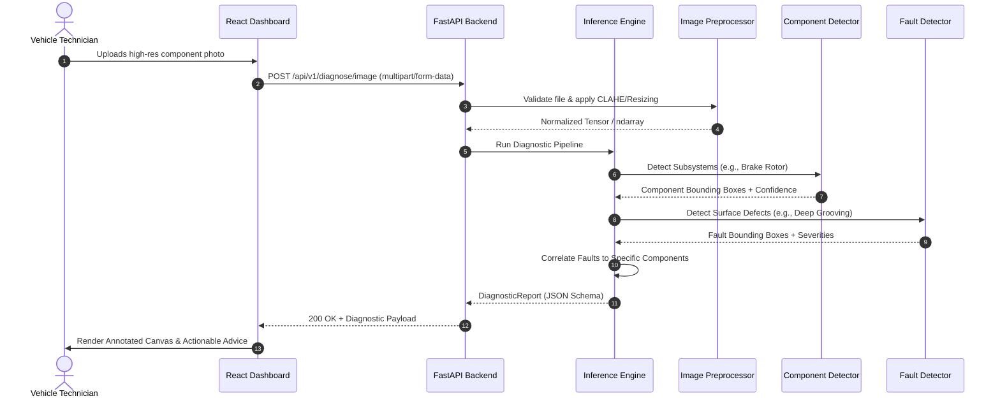

# System Architecture: AI-Powered Multimodal Vehicle Fault Detection and Diagnosis

## 1. High-Level Vision & Objectives
The **AI-Powered Multimodal Vehicle Fault Detection and Diagnosis System** is an end-to-end engineering solution designed to inspect, identify, and report mechanical, thermal, and visible degradation in vehicular subsystems.

Rather than treating fault diagnosis as an opaque monolithic black box, the system adopts a **modular two-stage visual perception hierarchy**:
1. **Stage 1 (Subassembly Localization):** Detects and crops automotive components (e.g., brake calipers, serpentine belts, battery terminals, radiator fins).
2. **Stage 2 (Defect & Anomaly Classification):** Pinpoints surface degradation, structural cracks, oxidation, fluid leaks, and abrasive wear within the localized regions.

---

## 2. Monorepo Architecture Overview

The codebase is organized into independent decoupled tiers:

```
┌────────────────────────────────────────────────────────┐
│                   Frontend Tier (React + Vite)         │
│  - Operator Dashboard  - Image Inspection Canvas       │
│  - Real-time Diagnostic Telemetry                      │
└───────────────────────────┬────────────────────────────┘
                            │ HTTP / REST / JSON
┌───────────────────────────▼────────────────────────────┐
│                   Backend Tier (FastAPI)               │
│  - API Gateway & Route Controllers                     │
│  - Input Validation & Payload Sanitization             │
│  - Asynchronous Orchestration                          │
└───────────────────────────┬────────────────────────────┘
                            │ In-Memory Pipeline Calls
┌───────────────────────────▼────────────────────────────┐
│                   Machine Learning Core                │
│  - Image Preprocessor (CLAHE, Normalization)           │
│  - Stage 1: Component Detector (YOLO/PyTorch)          │
│  - Stage 2: Visible Fault Detector (YOLO/PyTorch)      │
│  - Diagnostic Aggregator & Health Scoring Engine       │
└────────────────────────────────────────────────────────┘
```

---

## 3. Component Interaction Flow



---

## 4. Decoupling Principles
- **No Tight Coupling**: The ML core has zero dependencies on FastAPI or web servers; it operates as an independent Python library that can be executed via CLI, batch scripts, or imported into services.
- **Strict Verification**: Training and inference pipelines enforce pre-flight integrity checks. They fail with informative exceptions rather than generating fake or mocked detections.
- **Extensible Multimodality**: While Phase 1 focuses on high-resolution computer vision, the architecture reserves modular contracts (`data/raw/audio/`, multimodal feature fusion) for future acoustic signature diagnostic models.
